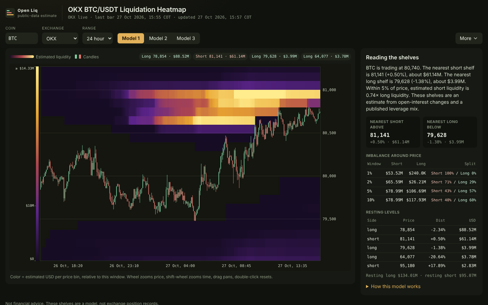
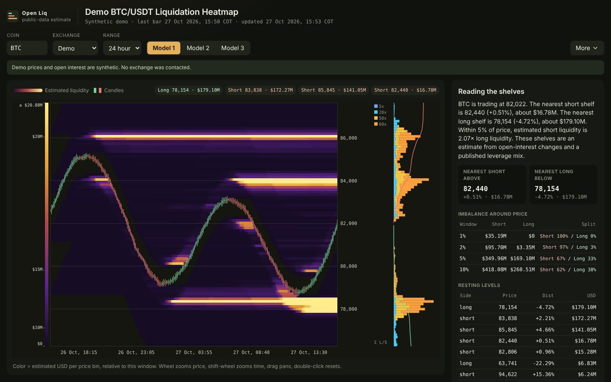
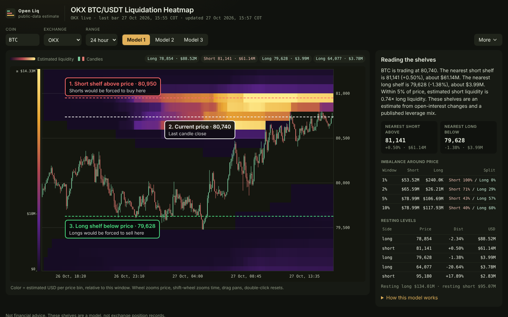
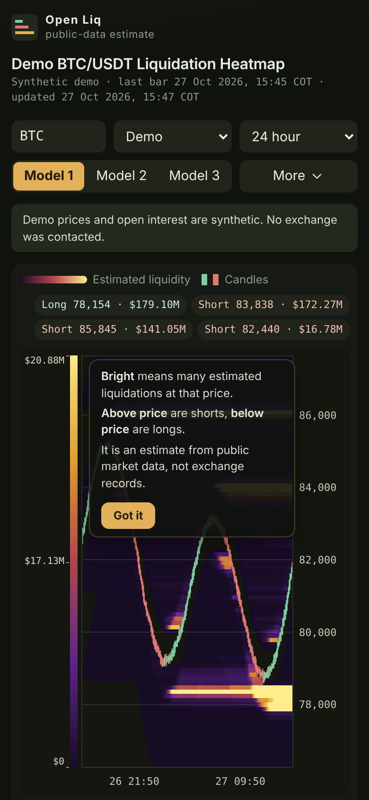

# Open Liquidation Heatmap

A free, open-source crypto liquidation heatmap you run on your own computer. No account, no subscription, every coin and range, and a method you can read line by line.



*Live OKX BTC/USDT, 24 hour, Model 1, captured 2026-10-27. Bright bands are prices where the model estimates many leveraged positions would be liquidated.*

```bash
pip install -r requirements.txt
python -m liqmap.server --open
```

Not financial advice. The map is an estimate built from public market data. It does not predict price.

## Why this exists

Liquidation heatmaps are popular with traders, but most of them sit behind paid services. Typical paid heatmap services charge a monthly subscription, limit the free tier to a few coins, put auto-refresh behind the paywall, and do not publish how the map is made. You pay for a picture you cannot check.

This project gives you the same kind of picture for free, and shows its work. Each claim in the right-hand column points to the file or flag that proves it.

| | Typical paid heatmap | Open Liquidation Heatmap |
| --- | --- | --- |
| Price | Monthly subscription | Free, MIT license ([LICENSE](LICENSE)) |
| Account | Sign-up required | None. It runs on your computer and only listens on `127.0.0.1` unless you pass `--host` ([liqmap/server.py](liqmap/server.py)) |
| Coins | Free tier limited to a few coins | Any USDT perpetual ticker on OKX or Binance, typed into the Coin box. Twenty are suggested ([`COINS` and `normalize_symbol` in liqmap/data.py](liqmap/data.py)) |
| Ranges | Depends on the plan | 12 hours to 2 years, nine ranges ([`RANGES` in liqmap/data.py](liqmap/data.py)) |
| Auto-refresh | Behind the paywall | Off, 30s, 1m or 5m, in the More drawer ([web/index.html](web/index.html), `#auto`) |
| Method | Closed | Every leverage weight and formula is in [`MODELS` in liqmap/model.py](liqmap/model.py), explained in [docs/HOW_IT_WORKS.md](docs/HOW_IT_WORKS.md) |
| History | Depends on the plan | Binance past views and replay back to 2020-09-01 ([`METRICS_START_S` in liqmap/data.py](liqmap/data.py), `/api/replay` in [liqmap/server.py](liqmap/server.py)) |
| Your data | Inside their website | A JSON API on your machine and a PNG snapshot button ([liqmap/server.py](liqmap/server.py)) |

The comparison is general and dated 2026-10-27. Individual services differ. This map is not more accurate than any paid map. Both are estimates, and different models draw different shelves.

## Quick start

You need Python 3.11 or newer.

```bash
pip install -r requirements.txt
python -m liqmap.server --open
```

Your browser opens http://127.0.0.1:8765. The page starts on live OKX BTC/USDT, 24 hour range, Model 1. No API key is needed.

| Flag | What it does |
| --- | --- |
| `--open` | Opens the page in your browser once the server is listening. |
| `--port 8765` | Port to listen on. 8765 is the default. |
| `--host 127.0.0.1` | Address to bind. The default keeps the page private to your computer. `--host 0.0.0.0` exposes it to your network. |

No internet, or just want to look around? Pick **Demo** in the Exchange menu. It draws a synthetic market and calls no exchange.



## Reading the chart



1. **Short shelf above price.** Estimated short positions that would be liquidated if price rose here. A short liquidation is a forced buy.
2. **Current price.** The last candle's close.
3. **Long shelf below price.** Estimated long positions that would be liquidated if price fell here. A long liquidation is a forced sell.

How to read it:

- **Brighter means more.** Color is the estimated USD that would be liquidated at that price, relative to this window.
- **Above price are shorts, below price are longs.**
- **A shelf disappears when price trades through it.** Those positions are assumed liquidated.
- **The side panel puts it in numbers.** It shows the nearest short shelf above, the nearest long shelf below, the short/long split within 1, 2, 5 and 10% of price (for example "Short 64% / Long 36%"), and a table of the biggest levels. A shelf's price there is its weighted middle, so it can sit a little off the brightest row.
- **Hover any cell** for price, time, estimated liquidity, the candle, and which leverage tiers make up the estimate.

The first time you open the page, a short guide over the chart says the same thing. Click "Got it" and it stays closed.

## Features

The page has one toolbar and a More drawer.

| Where | Control | What it does |
| --- | --- | --- |
| Toolbar | Coin | Any USDT perpetual ticker, like BTC, ETH, SOL or PEPE. Press Enter to load. |
| Toolbar | Exchange | OKX (live), Binance, All venues (OKX and Binance open interest summed), or Demo (synthetic, no network). |
| Toolbar | Range | 12 hour, 24 hour, 3 day, 7 day, 30 day, 90 day, 180 day, 1 year, 2 year. |
| Toolbar | Model 1 / 2 / 3 | Three published leverage mixes. Switching reuses the downloaded data. |
| More | Bar, As of, Replay | Binance only. Pick the bar size (5m to 1d), look at any past moment since 2020-09-01, or replay a span bar by bar. Space plays or pauses, the arrow keys step. |
| More | Threshold | Compresses the color ramp so weak cells stay dark and shelves stand out. Default 0.85. |
| More | Auto-refresh | Off, 30s, 1m or 5m. Paused while you look at a past moment. |
| More | Liquidation map | Side bars on the right with resting long and short liquidity, stacked by leverage tier. |
| More | Candles | Show or hide the candles. |
| More | Themes | Ember (default), Tide, Magma, Glacier. |
| More | Snapshot | Saves the chart as a PNG. |
| More | Fit / Wide | Fit price to the traded range, or show every price bin. |
| More | Refresh, Fullscreen | Fetch again, or fill the screen with the chart. |
| Chart | Zoom and pan | Wheel zooms price, shift-wheel zooms time, drag pans, double-click resets. |

Your settings are saved in your browser. Times are shown in COT (UTC−5).

It also works on a phone. Start the server with `--host 0.0.0.0` and open your computer's address from the phone on the same network.



### Still images from the command line

```bash
python heatmap.py --exchange demo --symbol ETHUSDT --range 7d --model 2 --outfile heatmap.png
```

This saves `heatmap.png` without opening a window. Use `--exchange okx` or `binance` for live data, and `--mode symbol` to sum OKX and Binance.

## How it works

Exchanges do not publish each trader's entry price or leverage. So the map infers them from public open interest, in five steps:

1. **New positions** are the change in open interest, counted in coins, priced at the bar where they happened (that bar's typical price, high + low + close over 3).
2. **Each new position is spread across a leverage mix** and placed at its isolated liquidation price, with a 0.5% maintenance margin.
3. **A level survives the bar that opened it.** A later candle that trades through it removes it. A wick that crosses only part of a price bin removes only that part.
4. **Model 2 fades with a 72-hour half-life.** Models 1 and 3 do not fade.
5. **Color is the resting USD at each price and time**, scaled to the window.

| Model | Idea | Leverage weights |
| --- | --- | --- |
| 1 Wide clusters (default) | Most weight on 50×–60×, with a far 5× tier. Longs and shorts split evenly. | 5× 12%, 20× 10%, 50× 25%, 60× 53% |
| 2 Tight magnets | Two tiers, a little turnover from volume, and a 72-hour fade. Longs and shorts split evenly. | 20× 30%, 60× 70% |
| 3 Flow skew | New positions follow taker buy and sell volume when the venue publishes it. | 10× 15%, 20× 20%, 25× 20%, 50× 25%, 100× 20% |

The whole model is [liqmap/model.py](liqmap/model.py). The full write-up, with formulas and sources, is [docs/HOW_IT_WORKS.md](docs/HOW_IT_WORKS.md). The page's "How this model works" panel reads the same table, so it cannot drift from the code.

**Calibration.** The Model 1 and 2 weights were checked by eye against a commercial heatmap's public page, so that the strongest shelves land at about the same distance from price. Nothing from that page ships with this repository. A re-check after the 2026-10-27 model fixes is pending. See [The weights are the model](docs/HOW_IT_WORKS.md#the-weights-are-the-model).

## FAQ

**Is it really free?**
Yes. It is MIT licensed. It uses only public exchange data, so there is no API key and nothing to pay for.

**Where does the data come from?**
OKX and Binance public endpoints: candles, open interest and taker volume. When Binance's live futures API is blocked on your network, the page falls back to Binance's public data archive, which lags a day or two. The page says so in a banner.

**Is this what the exchange sees?**
No. Exchanges do not publish where each position would be liquidated. This is a model built from assumptions you can read and change.

**Why do Model 1, 2 and 3 disagree?**
They assume different leverage mixes. Nobody outside the exchange knows the real mix. Comparing them shows how much the picture depends on that guess.

**Can I share it with my team?**
Run it with `--host 0.0.0.0` on a machine they can reach. There is no login, so only do that on a network you trust.

**Is there an API?**
Yes, on the same server. `GET /api/heatmap` returns the map as JSON, `GET /api/levels` the leverage breakdown at one price and time, `GET /api/replay` loads a Binance replay, and `GET /api/status` and `GET /api/symbols` list models, ranges and coins. See [liqmap/server.py](liqmap/server.py).

**How do I run the tests?**

```bash
pip install -r requirements-dev.txt
python -m pytest
```

Tests that need the network are skipped. CI runs the suite on Python 3.11, 3.12 and 3.13. The browser smoke check is `node tests/ui/smoke.cjs`. It needs Node and Playwright, and it refreshes the Demo screenshots in `docs/img/`.

## Limitations

- **It is an estimate.** It is not the exchange's liquidation engine, and it does not predict price. Use it as context, not as a target.
- **The leverage mix is an assumption.** So are the 0.5% maintenance margin and the even long/short split in Models 1 and 2.
- **No cross margin, tiered maintenance, fees or funding** in the default map. Those exist on `heatmap.liq_price` but are not used.
- **Closes are not identified.** When open interest falls, the model trims every level in proportion.
- **The Binance archive lags.** On networks where Binance's live API is blocked, Binance data is a day or two old. All venues mode leaves a stale Binance book out rather than mixing old open interest with today's price.
- **Different venues and models draw different shelves.**

This project is not affiliated with any heatmap service or exchange. It does not scrape, copy or redistribute anyone's heatmap.

## License

MIT. See [LICENSE](LICENSE).
