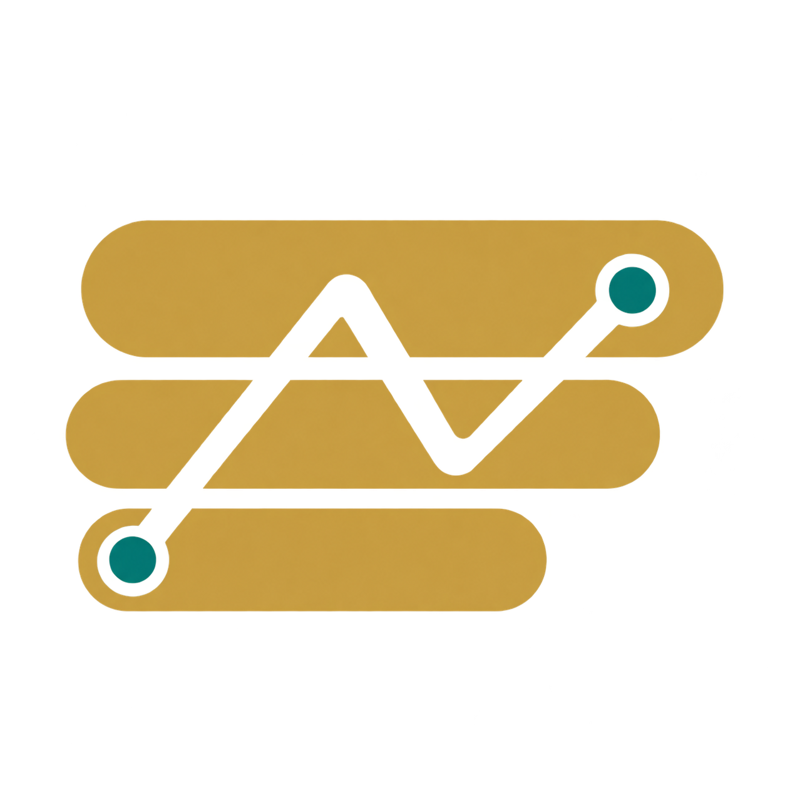
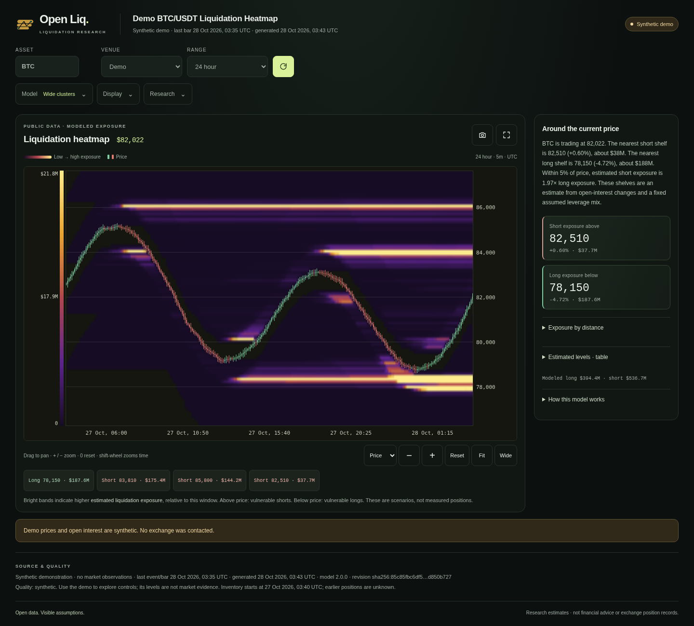
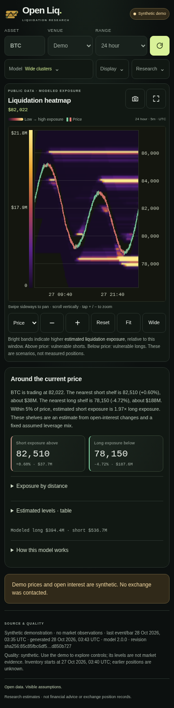
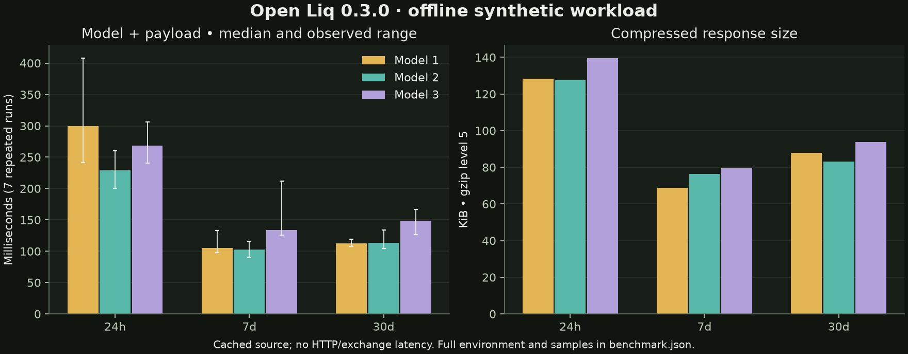

<p align="center">
  
</p>
<h1 align="center">Open Liq</h1>
<p align="center"><strong>Public data. Visible assumptions. Reproducible liquidation research.</strong></p>
<p align="center">
  
  
  
  
  <a href="LICENSE"></a>
</p>
<p align="center">
  <a href="#quickstart">Quickstart</a> · <a href="docs/API.md">API reference</a> · <a href="docs/HOW_IT_WORKS.md">Methodology</a> · <a href="docs/VALIDATION.md">Validation</a> · <a href="examples/research.py">Research example</a> · <a href="docs/RELEASE_REVIEW.md">Release evidence</a>
</p>

Open Liq turns public perpetual-market candles and open interest into **inspectable liquidation scenarios**. Use the chart to explore price concentrations, or the local API to record exact model features for algorithmic research. No exchange API key is required.

**A heatmap is an estimate, not exchange position records.** This project does not demonstrate a trading edge or claim numerical equivalence to CoinGlass. It is independent of CoinGlass, does not scrape its heatmaps, and does not redistribute its data.



## Quickstart

Python 3.11 or newer:

```bash
git clone https://github.com/Robertzu43/open-liquidation-heatmap.git
cd open-liquidation-heatmap
python -m venv .venv
source .venv/bin/activate
python -m pip install .
liqmap
```

Open **http://127.0.0.1:8765**. The default market is live OKX BTC/USDT. The server binds to your local machine unless explicitly configured otherwise.

For offline exploration, open **http://127.0.0.1:8765/?exchange=demo&coin=BTC&range=24h&model=1**. Demo prices and positions are synthetic and labeled as such. A failed live request never silently becomes demo data.

On Windows, activate with `.venv\Scripts\activate`. Running directly from the checkout remains supported with `pip install -r requirements.txt` followed by `python -m liqmap.server`.

## Built for research

| Capability | What it provides |
|---|---|
| Three transparent scenarios | Published leverage weights, margin assumptions, flow prior and elapsed-time decay |
| Corrected causal inventory | Native-OI flow accounting; close-created cohorts cannot be swept by an earlier wick; rendering bins do not decide liquidation |
| Venue-aware aggregation | Independent venue state, explicit missing observations and source coverage |
| Research API | Versioned envelope, exact features, units, data fingerprint and model parameter digest |
| Historical views and replay | Binance closed-bar archive views, cached replay and explicit reconstruction limits |
| Local recorder | Bounded capture, hash verification, offline inspection and feature CSV export |
| Reference comparison | Strictly aligned user-normalized reference exports; agreement is not ground truth |
| Responsive chart | Compact phone layout, keyboard/touch controls, UTC/local display, shareable views, PNG and JSON exports |
| Local-first installation | Wheel packaging, console commands, offline demo, no paid runtime service |

Read [what changed in 0.3.0](CHANGELOG.md) before reusing thresholds from an older model. **Application 0.3.0, API 1.0 and model 2.0.0 are separate versions.**

## Read the chart

Bright bands mean higher **estimated liquidation exposure relative to this window**. Above price, they represent vulnerable short scenarios; below price, vulnerable long scenarios. They are not resting bids/asks or guaranteed price magnets.

Choose an asset, venue and range first. The **Model**, **Display** and **Research** panels hold advanced controls. Hover or tap to inspect, use the Price/Time zoom selector and +/− buttons, and reset with `0`. Keyboard and touch affordances are described alongside the chart. Mobile vertical gestures scroll the page; horizontal gestures pan the chart.

<p align="center"></p>

Source and quality information distinguishes synthetic, stale, degraded, observed and unknown data. Response generation time does not establish source freshness. The sidebar's shelves summarize display bins; use the API's exact economic features for research independent of chart resolution.

## Use the API

```python
import requests

response = requests.get(
    "http://127.0.0.1:8765/api/v1/features",
    params={"exchange": "demo", "symbol": "BTC", "range": "24h", "model": 1},
    timeout=30,
)
response.raise_for_status()
view = response.json()
print(view["model_version"], view["quality"]["status"])
print(view["feature_as_of"], view["features"])
```

Start with [API.md](docs/API.md) and the [OpenAPI specification](docs/openapi.json) for query parameters, field semantics, grid decoding and errors. Select a longer `range` for model history and a smaller `visible_bars` for its displayed tail; the hidden observations still seed the model. `/healthz` checks the process; `/readyz` separately reports the cached default live market. Unknown or stale data is not ready.

Capture a response and inspect it offline:

```bash
liqmap-research record \
  --url 'http://127.0.0.1:8765/api/v1/features?exchange=demo&symbol=BTC&range=12h&model=1' \
  --directory /tmp/open-liq-captures
liqmap-research inspect /tmp/open-liq-captures/*.json
liqmap-research export /tmp/open-liq-captures/*.json > /tmp/features.csv
python examples/research.py
```

The [research guide](docs/VALIDATION.md) explains tamper-evident hashes, normalized reference input, chronological held-out diagnostics and why reconstructed archives cannot establish historical publication times. It includes a strategy input contract for costs/slippage; the toolkit does not place trades.

## Data coverage and limitations

| Source | Behavior |
|---|---|
| OKX | Public swap candles, native open interest and available taker data; default live venue |
| Binance | Public live USDT-M data where reachable; public archive fallback when needed |
| Binance archives | Delayed public history; as-of/replay supported, original publication availability generally unknown |
| Aggregate | Available fresh OKX/Binance venue inventories; excluded or missing sources remain explicit |
| Demo | Seeded synthetic series, no exchange calls |

Ranges run from 12 hours to 2 years, with bar sizes selected by range and upstream availability. A requested long range does not guarantee that a venue has complete OI history. Time travel and custom bar selection are Binance pair features. Operational caps and cache behavior are in [OPERATIONS.md](docs/OPERATIONS.md).

The model assumes leverage allocations, simplified isolated maintenance margin and close entries. Trade-price candles approximate mark-price liquidation triggers. Positions that predate the observation anchor are unknown. Historical archives do not reveal account collateral or prove point-in-time data availability. These limitations are carried in metadata and [explained in the methodology](docs/HOW_IT_WORKS.md).

## Measured performance



This is a **local synthetic workload measurement**, with cached source data and freshly computed models/payloads. It excludes HTTP and exchange latency and is neither an uptime claim nor an accuracy benchmark. The chart shows medians and observed min/max over seven repetitions per case. Different ranges contain different bar counts.

[Raw environment and samples](docs/assets/benchmark.json) · Reproduce with `python scripts/benchmark.py`.

## Verification and development

```bash
python -m pip install '.[dev,browser]'
python -m pytest -q -ra
node --check web/app.js
python -m playwright install chromium
python -m liqmap.server --port 8767
# In another terminal:
python tests/browser/smoke.py --url http://127.0.0.1:8767
python scripts/check_install.py
```

The [CI workflow](.github/workflows/ci.yml) covers Python tests, wheel installation away from the checkout, JavaScript syntax and offline browser acceptance. The browser suite exercises normal controls, failures/recovery, replay, exports and responsive layouts. Live exchange tests are separate from deterministic offline checks. Local results and unverified platforms are recorded in the [release review](docs/RELEASE_REVIEW.md); a committed workflow is not evidence of a successful remote CI run.

## Replacing a paid data provider?

Open Liq gives you inspectable modeling and control of your research inputs. It is **not a drop-in replacement** for a provider-specific strategy: coverage, timing, definitions and estimates differ. Compare authorized, timestamp-aligned datasets; freeze parameters; evaluate held-out outcomes after costs; and shadow-run before deciding. No provider dataset or prospective trading evidence was available for this release.

[Migration](docs/MIGRATION.md) · [Operations](docs/OPERATIONS.md) · [Validation](docs/VALIDATION.md) · [Changelog](CHANGELOG.md)

## License

MIT. See [LICENSE](LICENSE). Public-market data retain their providers' terms. Not financial advice.
