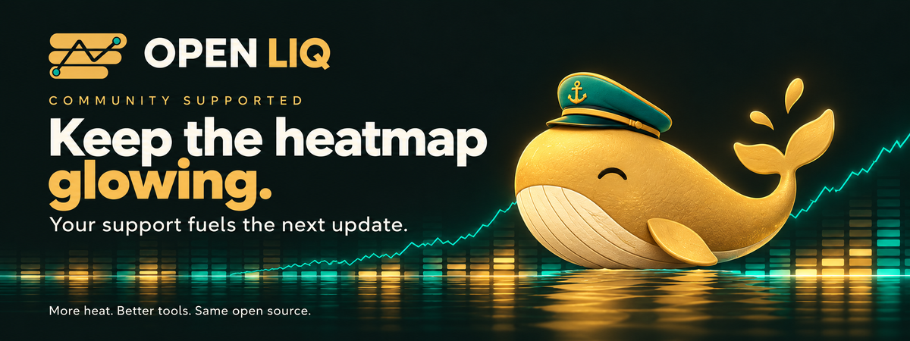
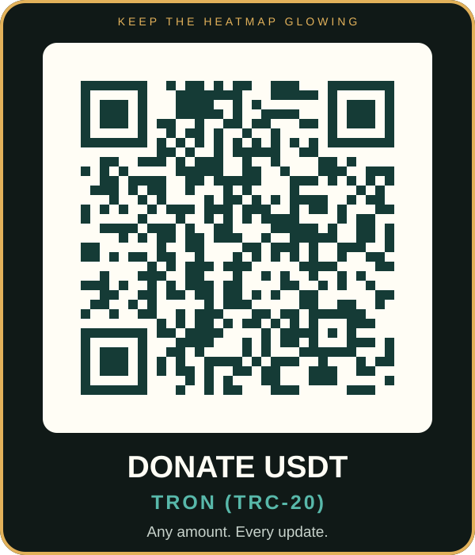

<p align="center">
  
</p>
<h1 align="center">Open Liq</h1>
<p align="center"><strong>Public data. Visible assumptions. Reproducible liquidation research.</strong></p>
<p align="center">
  
  
  
  
  <a href="LICENSE"></a>
</p>
<p align="center">
  <a href="#quickstart">Quickstart</a> · <a href="#read-the-chart-in-30-seconds">Read the chart</a> · <a href="#run-with-a-coding-agent">For coding agents</a> · <a href="docs/API.md">API reference</a> · <a href="docs/HOW_IT_WORKS.md">Methodology</a> · <a href="docs/VALIDATION.md">Validation</a> · <a href="examples/research.py">Research example</a> · <a href="docs/RELEASE_REVIEW.md">Release evidence</a>
</p>

Open Liq is a free liquidation heatmap for crypto futures traders that runs on your own computer. It estimates where leveraged longs and shorts on OKX, Binance and Bybit USDT perpetuals would be liquidated if price moved there, and draws those levels as bands around the price chart. Beside the estimate it shows what the exchanges actually report: open interest, funding and recent OKX liquidation orders. You need no exchange account and no API key, and Open Liq never sees your positions. Every assumption behind the bands is published, and a local API returns the same numbers for your own research.

> **Read this once.** The bands are a **model estimate** built from public candles and open interest. They are not exchange position records, resting orders or a forecast. The liquidation dots and the funding and open-interest figures are exchange data; the bands are not. Open Liq does not demonstrate a trading edge. It is independent of CoinGlass, does not scrape its heatmaps, does not redistribute its data and does not claim to match its numbers. Not financial advice.

## Run with a coding agent

**Copy and paste this prompt:** Click the copy button at the top-right of the box, then paste it into a coding agent that has access to the computer where you want to run Open Liq.

```text
Help me run Open Liq, the open-source liquidation heatmap at
https://github.com/Robertzu43/open-liquidation-heatmap.

Use an existing checkout if available; otherwise clone the repository without
overwriting any files. Check for Python 3.11 or newer, create or reuse a virtual
environment, install the project, and start the server on 127.0.0.1:8765. If
that port is in use, check whether Open Liq is already running and whether its
reported version matches the checkout. If it does not match, use an available
local port instead; do not stop or modify someone else's process. Report the
checkout revision, and do not overwrite local changes. Keep the server running
while I test it.

Verify the health endpoint and load the offline demo, then give me the exact
browser URL. If you can open a browser on this same computer, open it. If you
are running remotely, explain how I can access the server through an available
port-forwarding or preview feature; do not assume your localhost is mine.
Help me switch to the public live market data and use the local API if I ask.

Use only the public, keyless data sources. Do not request my exchange API keys,
passwords, or account details, and do not connect to my trading account or
place orders. Explain that liquidation exposure is a model estimate, not my
account positions or a record of actual liquidations.
```

Open Liq uses free public market endpoints from OKX, Binance and Bybit, plus Binance's public archives. It does not need an exchange account or read your account positions. The exchanges receive normal network requests, including your IP address, and may impose rate limits or geographic restrictions.

## Quickstart

Python 3.11 or newer. On macOS and Linux:

```bash
git clone https://github.com/Robertzu43/open-liquidation-heatmap.git
cd open-liquidation-heatmap
python3 -m venv .venv
source .venv/bin/activate
python3 -m pip install .
liqmap
```

Open **http://127.0.0.1:8765**. The default market is live OKX BTC/USDT. Switch the venue to Binance, Bybit or All venues from the venue menu. Live views refresh every 60 seconds by default. The server binds to your local machine unless explicitly configured otherwise.

For offline exploration, open **http://127.0.0.1:8765/?exchange=demo&coin=BTC&range=24h&model=1**. Demo prices and positions are synthetic and labeled as such. A failed live request never silently becomes demo data.

On Windows, create the environment with `py -3 -m venv .venv`, then activate it with `.venv\Scripts\activate` and install with `python -m pip install .`. Running directly from the checkout remains supported with `pip install -r requirements.txt` followed by `python -m liqmap.server`.

## Read the chart in 30 seconds


*Screenshot captured from live OKX BTC/USDT on October 29, 2026. Prices, open interest, funding and the liquidation dots are exchange observations; the bands are modeled. The dashed line marks where the published OKX liquidation feed begins; earlier dots were not available, not absent.*

1. **Pick a market.** Choose the coin, the venue (OKX, Binance, Bybit or All venues) and the time range.
2. **Read the bands.** A brighter band means more estimated liquidation exposure at that price, relative to the rest of this window.
   - **Above price: short liquidation clusters.** Shorts that would be liquidated if price rose into the band.
   - **Below price: long liquidation clusters.** Longs that would be liquidated if price fell into the band.
   - When a candle trades through a cluster, the model removes it. Bands are not resting orders and not guaranteed price targets.
3. **Read the line above the chart.** It names the nearest short cluster above price and the nearest long cluster below, with each one's distance in percent and estimated size in USD. It also gives the ratio of short to long exposure within ±5% of price.
4. **Check the dots.** Dots are real, filled OKX liquidation orders, not model output. **Red dots are longs that were liquidated. Green dots are shorts that were liquidated.** Each dot sits at OKX's reported bankruptcy price. The dots come from OKX only, whichever venue the bands show.
5. **Check the market strip.** It shows open interest, the change in open interest and in price over the window, the current funding rate and the countdown to the next funding. Open interest is in USD, so it also rises and falls with price. Compare the two changes before reading new positions into it.
6. **Scan the watchlist.** Track up to six coins, each with its price, price change and nearest short and long clusters.
7. **Replay a move.** The Replay panel steps through the **Last 24h**, **3 days** or **7 days** from the Binance archive. Price and modeled exposure appear together as each bar arrives.
8. **Set an alert (optional).** Choose a distance in percent. When price comes within it of the nearest cluster, the page shows a message and, if you allow it, a browser notification. The alert runs in the open page only.

Disclaimers sit in one footer line. Open **Source & quality** for the source, freshness and coverage of the data on screen: synthetic, stale, degraded, observed or unknown. Response generation time is not source freshness.

The three models are different leverage assumptions, not better and worse versions: **1 · Wide clusters** (default), **2 · Tight magnets** and **3 · Flow skew**. Their weights are in the [methodology](docs/HOW_IT_WORKS.md#three-published-scenarios).

Traders use a liquidation map as context: where forced orders could add to a move, where to set an alert, and how venues compare. It does not tell you direction or timing.

The **Model**, **Display**, **Research** and **Replay** panels hold advanced controls: scenarios, display and alert options, exports, and historical as-of views with replay. Hover or tap to inspect, use the Price/Time zoom selector and +/− buttons, and reset with `0`. Zoomed heatmaps show crisp bin boundaries; finer display bins do not prove greater model accuracy. Keyboard and touch affordances are described alongside the chart. Mobile vertical gestures scroll the page; horizontal gestures pan the chart.

<p align="center"></p>

[View a historical replay screenshot](docs/assets/replay.png). It was captured from the Binance archive: a BTC/USDT replay from October 20 to 23, 2026 on 15-minute bars, paused at frame 180 of 289. Price and exposure appear as each historical bar arrives; the empty area is future time. Earlier modeled exposure can change as the lookback window moves.

The sidebar and reading line summarize display bins. For research that must not depend on chart resolution, use the API's exact economic features.

## Features

| Feature | What you get |
|---|---|
| Liquidation heatmap | Estimated short clusters above price and long clusters below, for OKX, Binance, Bybit or all three combined |
| Three published scenarios | Leverage weights, margin assumptions, flow prior and elapsed-time decay are all documented |
| Trader reading line | Nearest short and long cluster, distance, estimated size and ±5% short-to-long ratio |
| Observed liquidations | Recent filled OKX liquidation orders drawn on the chart as dots |
| Market strip | Open interest, open-interest change, price change, funding rate and next-funding countdown |
| Watchlist | Up to six coins with their price, price change and nearest clusters |
| Replay and history | Binance archive replay with 24h / 3-day / 7-day presets, as-of views and bar choice |
| Price-proximity alert | In-page message and optional browser notification near the nearest cluster |
| Causal inventory | Native-OI flow accounting; close-created positions cannot be swept by an earlier wick; display bins do not decide liquidation |
| Venue-aware aggregation | Independent venue inventories; missing or stale venues are left out and reported |
| Research API | Versioned envelope, exact features, units, market context, data fingerprint and parameter digest |
| Local recorder | Bounded capture, hash verification, offline inspection and feature CSV export |
| Reference comparison | Strictly aligned user-normalized reference exports; agreement is not ground truth |
| Responsive chart | Phone layout, keyboard/touch controls, UTC/local display, shareable views, PNG and JSON exports |
| Local-first installation | Wheel packaging, console commands, offline demo, no paid runtime service |

Read [what changed in 0.4.0](CHANGELOG.md). **Application 0.4.0, API 1.0 and model 2.0.0 are separate versions.** The model is unchanged from 0.3.1. All venues now includes Bybit, so its totals differ from 0.3.1.

## Data coverage

| Source | What Open Liq uses | Notes |
|---|---|---|
| OKX | USDT perpetual candles, native open interest, taker flow where available, funding, recent filled liquidation orders | Default venue. The only source of observed liquidations |
| Binance | USDT-M perpetual candles, native open interest, taker flow, funding | Falls back to the public archive when the live API is blocked |
| Binance archives | Delayed public history | As-of views and replay. Original publication time is generally unknown |
| Bybit | USDT perpetual candles, native open interest, funding (public v5 API) | No historical taker flow, so Flow skew is neutral for Bybit. 12-hour bars use the last 4-hour OI snapshot in each bar. No archive fallback: if Bybit blocks your region, it is reported unavailable |
| All venues | OKX, Binance and Bybit inventories, each kept separate before summing | A missing or stale venue is left out, and coverage is reported as degraded |
| Demo | Seeded synthetic series | No exchange calls |

**Not supported, on purpose:**

- **Hyperliquid and other venues without public historical open interest.** The model builds positions from changes in open interest over time, so it needs OI history.
- **Anything other than USDT-margined linear perpetuals.** No coin-margined contracts, USDC contracts, spot or options.
- **Observed liquidations from Binance or Bybit.** Both publish liquidations only over websocket streams. Open Liq fetches data on request and runs no background stream recorder, so observed liquidations come from OKX only.
- **Trading.** No order placement and no account access.

Ranges run from 12 hours to 2 years, with bar sizes selected by range and upstream availability. A requested long range does not guarantee that a venue has complete OI history. Time travel, replay and custom bar selection are Binance pair features. Operational caps and cache behavior are in [OPERATIONS.md](docs/OPERATIONS.md).

The model assumes leverage allocations, simplified isolated maintenance margin and close entries. Trade-price candles approximate mark-price liquidation triggers. Positions that predate the observation anchor are unknown. Historical archives do not reveal account collateral or prove point-in-time data availability. These limitations are carried in metadata and [explained in the methodology](docs/HOW_IT_WORKS.md).

## Use the API

```python
import requests

response = requests.get(
    "http://127.0.0.1:8765/api/v1/features",
    params={"exchange": "demo", "symbol": "BTC", "range": "24h", "model": 1},
    timeout=30,
)
response.raise_for_status()
view = response.json()
print(view["model_version"], view["quality"]["status"])
print(view["feature_as_of"], view["features"])
print(view["market_context"])  # price, OI and OI change over the displayed window
```

Funding and open interest per venue, nearest clusters for several coins, and observed OKX liquidations:

```bash
curl 'http://127.0.0.1:8765/api/v1/context?exchange=aggregate&symbol=BTC&mode=symbol'
curl 'http://127.0.0.1:8765/api/v1/watchlist?exchange=okx&range=24h&symbols=BTC,ETH,SOL'
curl 'http://127.0.0.1:8765/api/v1/liquidations?exchange=okx&symbol=BTC&range=24h'
```

`funding_rate` is a fraction per funding interval: `0.0001` is 0.01%. The liquidations route returns observed OKX orders, not model output.

Start with [API.md](docs/API.md) and the [OpenAPI specification](docs/openapi.json) for query parameters, field semantics, grid decoding and errors. Select a longer `range` for model history and a smaller `visible_bars` for its displayed tail; the hidden observations still seed the model. `/healthz` checks the process; `/readyz` separately reports the cached default live market. Unknown or stale data is not ready.

## Research and recording

Capture a response and inspect it offline:

```bash
liqmap-research record \
  --url 'http://127.0.0.1:8765/api/v1/features?exchange=demo&symbol=BTC&range=12h&model=1' \
  --directory /tmp/open-liq-captures
liqmap-research inspect /tmp/open-liq-captures/*.json
liqmap-research export /tmp/open-liq-captures/*.json > /tmp/features.csv
python examples/research.py
```

The [research guide](docs/VALIDATION.md) explains tamper-evident hashes, normalized reference input, chronological held-out diagnostics and why reconstructed archives cannot establish historical publication times. It includes a strategy input contract for costs/slippage; the toolkit does not place trades.

## Measured performance


The chart measures **local synthetic workloads**, with cached source data and freshly computed models/payloads. It excludes HTTP and exchange latency. It shows medians and observed min/max over seven repetitions per case; different ranges contain different bar counts. The raw report also records a fresh local server’s cold/warm HTTP requests, a concurrent burst and observed memory, against declared small-workload budgets. Neither measurement establishes a production SLA, maximum-load bound or model accuracy.

[Raw environment and samples](docs/assets/benchmark.json) · Reproduce with `python scripts/benchmark.py`.

## Verification and development

```bash
python -m pip install '.[dev,browser]'
python -m ruff check .
python -m pytest -q -ra
node --check web/app.js
python -m playwright install chromium
python -m liqmap.server --port 8767
# In another terminal:
python tests/browser/smoke.py --url http://127.0.0.1:8767
python scripts/check_install.py
```

There is no hosted CI. Run these commands before every push: lint, the Python suite, JavaScript syntax, offline browser acceptance and wheel installation away from the checkout. The browser suite exercises normal controls, failures and recovery, replay, exports, the watchlist, liquidation dots and responsive layouts. Live exchange tests are opt-in: `RUN_NETWORK=1 python -m pytest -q -m network` checks the public venues reachable from your network. Local results and unverified platforms are recorded in the [release review](docs/RELEASE_REVIEW.md).

## Replacing a paid data provider?

Open Liq gives you inspectable modeling and control of your research inputs. It is **not a drop-in replacement** for a provider-specific strategy: coverage, timing, definitions and estimates differ. Compare authorized, timestamp-aligned datasets; freeze parameters; evaluate held-out outcomes after costs; and shadow-run before deciding. No provider dataset or prospective trading evidence was available for this release.

[Migration](docs/MIGRATION.md) · [Operations](docs/OPERATIONS.md) · [Validation](docs/VALIDATION.md) · [Changelog](CHANGELOG.md)

## Keep the heatmap glowing



If Open Liq helps your research, support its continued development with a **USDT donation of any amount**. Small tips or whale-sized splashes—every contribution is appreciated. 🐋

Your support helps fund the development time behind more reliable data, clearer charts, better research tools, and the next round of improvements. **More heat. Fewer bugs.**

<p align="center">
  <a href="docs/assets/usdt-trc20-card.svg"></a>
</p>

**USDT · Tron (TRC-20)** — scan the QR or copy the address:

```text
TPj94QSBd141u2gNpCHPFP9DAUwewqWTTs
```

The QR contains the address only. Choose **USDT on Tron (TRC-20)** and your donation amount in your wallet. [Open the plain QR](docs/assets/usdt-trc20.png).

### Hall of Heat 🏆

A little spotlight for the people keeping the charts glowing. Every **verified, opted-in supporter** gets a thank-you in the next release notes. The top three ranks also receive a README spotlight and these entirely honorary titles:

| Rank | Your entirely unofficial title |
| --- | --- |
| 🥇 #1 | **Chief Heat Officer** — keeping the pixels toasty |
| 🥈 #2 | **Liquidity Legend** — making a splash for open source |
| 🥉 #3 | **Candle Keeper** — helping the next update shine |

Every other opted-in supporter joins the **Heat Crew**. Anonymous support is just as welcome. No verified supporters are listed yet—the first confirmed splashes will set the pace.

[Meet the supporters and see how ranking works](docs/SUPPORTERS.md) · [Request a shoutout](https://github.com/Robertzu43/open-liquidation-heatmap/issues/new?template=supporter.yml)

Recognition is optional and updated manually after confirmation. Rankings use cumulative verified USDT received from participating supporters.

## License

MIT. See [LICENSE](LICENSE). Public-market data retain their providers' terms. Not financial advice.
