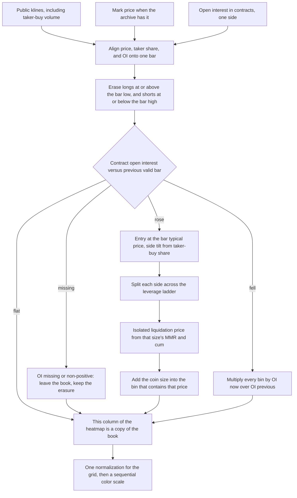

# How liquidation heatmaps work

**Where this repository is.** [The pipeline](#the-pipeline) and [How a level dies](#how-a-level-dies) describe the general model. `liqmap/model.py` builds a stock book: it carries levels forward, sweeps them with each bar's range, scales them when open interest falls, and in model 2 fades them. It does not use the mark price or margin brackets. What the code does today is in [Implementation status](#implementation-status).

A liquidation heatmap is a picture of an estimate: at which prices a move would force leveraged perpetual positions to close, and how much size the model assigns to each price.

The horizontal axis is time. The vertical axis is price. Color is the estimated notional (or coin size) whose liquidation price falls in that bin and is still open under the model's rules. Bands below the current price are estimated long liquidations. If the mark price trades down into them, those longs are sold. Bands above the current price are estimated short liquidations. If the mark price trades up into them, those shorts are bought back.

Exchanges do not publish the inputs that would turn this picture into a measurement. A position's liquidation price depends on its entry price, its leverage, how much extra collateral sits behind it, whether that collateral is isolated to the position or shared across the account, and the maintenance-margin schedule. On Binance, Bybit, and OKX those facts stay inside the account. What is public is the aggregate open interest, the candles, the venue's margin rules, and (on some venues) a throttled feed of liquidations that already happened. Every heatmap built from that public set is a model of something it cannot see. That is the starting point of [Blocklens's methodology](https://docs.blocklens.co/lab/liquidation-map), of [AlertaChart's write-up](https://www.alertachart.com/learn/liquidation-heatmap), and of [Coinliqui's](https://coinliqui.com/learn/liquidation-heatmap). The same point is made in shorter form by [Bitsgap](https://bitsgap.com/blog/crypto-liquidation-heatmap-explained) and [WinCAlgo](https://wincalgo.com/en/guides/liquidation-heatmap).

This repository follows that public idea. It does not scrape CoinGlass, call private CoinGlass endpoints, or ship CoinGlass data. Nothing below is taken from CoinGlass, except that the leverage split of Models 1 and 2 was calibrated by eye against its rendered chart (see [The weights are the model](#the-weights-are-the-model)).

Two different charts are easy to mix up:

| | Estimated heatmap | Realized liquidations |
| --- | --- | --- |
| Question it answers | Where would open positions be forced closed if the mark price got there? | Where did forced closes already print? |
| Inputs | Open interest, price, a leverage assumption, the venue's margin rule | Exchange liquidation events |
| What a bright cell is | A pile of hypothetical triggers | Nothing. Realized prints are a separate series |

A bright band is not a pool of resting bids or asks. A liquidation is not an order that sits in the book waiting. It is a forced close the engine creates when collateral falls through the maintenance requirement. The forced order consumes liquidity. It does not provide it.

## What the exchange actually computes

### The trigger is the mark price

On Binance USDⓈ-M futures, a position is liquidated when its collateral (wallet balance, realized PnL, and unrealized PnL) falls below maintenance margin, and that condition is evaluated on the **mark price**, not the last traded price. Binance states both rules in [Liquidation Protocols](https://www.binance.com/en/support/faq/binance-futures-liquidation-protocols-360033525271). Bybit states the same mark-price trigger for isolated positions in its [Unified Trading Account liquidation rules](https://www.bybit.com/en/help-center/article/UTA-Trading-Rules-Liquidation-Process). OKX liquidates from the mark price when the maintenance-margin ratio reaches 100 percent, and it labels the price shown on the position as an estimate rather than the fill ([liquidation FAQ](https://www.okx.com/en-sg/help/liquidation-faq)).

Binance builds the USDⓈ-M perpetual mark price as the median of three numbers ([Mark Price and Price Index](https://www.binance.com/en/support/faq/what-are-mark-price-and-price-index-in-usd%E2%93%A2-margined-futures-360033525071)):

- **Price 1.** Index price times `1 + last funding rate × (time until the next funding / funding interval)`.
- **Price 2.** Index price plus a 2.5-minute moving average of the contract's basis. The basis sample is the mid of the best bid and ask, minus the index, taken every 5 seconds (30 samples).
- **Contract price.** The last price of the perpetual itself.

The median throws away whichever of the three is the outlier. A last-price wick can stab through a level without the mark price following it, and the mark price can touch a level without the last-price candle's wick printing there. A heatmap that erases levels with last-price high and low is therefore slightly early on some bars and slightly late on others. The series that matches the trigger is the mark price.

In a fast move the fill is not the theoretical trigger. Binance's own example is a short whose computed liquidation price was 17,006 while the mark jumped from 17,000 to 17,100 inside a second; the position was closed at 17,100 ([Liquidation Protocols](https://www.binance.com/en/support/faq/binance-futures-liquidation-protocols-360033525271)). The heatmap stores the trigger, not the print.

### Maintenance margin is a ladder, not a single rate

Maintenance margin is the minimum collateral that keeps the position open. On Binance USDⓈ-M it is

```text
maintenance margin = notional × MMR − maintenance amount
```

with the rate and the amount taken from the bracket the position's notional falls into ([Leverage and Margin of USDⓈ-M Futures](https://www.binance.com/en/support/faq/leverage-and-margin-of-usd%E2%93%A2-m-futures-360033162192)). The bracket applies to the whole position, not only to the slice above the previous cap. The maintenance amount exists so the dollar requirement does not jump at the boundary.

Verify the live brackets before relying on the table. `GET /fapi/v1/leverageBracket` returns them; the request is signed. Binance geo-restricts the futures API from some regions, so a call that fails on one network can succeed on another. The rows below are two public write-ups of that endpoint. [Coinline](https://coinline.ai/academy/binance-maintenance-margin-liquidation-guide/) reports a read on 2026-10-18 UTC (`updateTime` 2025-08-19 UTC). [The leverage calculator notes](https://cryptoleveragecalculator.app/binance-futures-calculator/) report a read on 2026-10-23 13:15 UTC. Both give:

| Bracket | Notional (USDT) | Max leverage | MMR | Maintenance amount (USDT) |
| --- | ---: | ---: | ---: | ---: |
| 1 | 0 – 300,000 | 150× | 0.40% | 0 |
| 2 | 300,000 – 800,000 | 100× | 0.50% | 300 |
| 3 | 800,000 – 3,000,000 | 75× | 0.65% | 1,500 |
| 4 | 3,000,000 – 12,000,000 | 50× | 1.00% | 12,000 |
| 5 | 12,000,000 – 70,000,000 | 25× | 2.00% | 132,000 |
| 6 | 70,000,000 – 100,000,000 | 20× | 2.50% | 482,000 |

ETHUSDT matches those rates on the first rungs; the upper notional caps differ. SOL and smaller contracts have their own tables. Brackets move. The official table is the [Leverage and Margin rules page](https://www.binance.com/en/futures/trading-rules/perpetual/leverage-margin) and, for an authenticated key, `GET /fapi/v1/leverageBracket`.

Check the boundary so the maintenance amount is not a mystery. At 300,000 USDT, bracket 1 gives `300,000 × 0.004 − 0 = 1,200`. Bracket 2 gives `300,000 × 0.005 − 300 = 1,200`. Same dollars, higher marginal rate above the cut.

Leverage chosen by the trader sets the **initial** margin (`notional / leverage`). It does not set the maintenance rate. A 10× position and a 100× position of the same small size sit in the same bracket and share the same MMR. The 100× position posts less collateral, so its liquidation price is closer to the entry. The bracket does two further things: a larger position is charged a higher MMR, and the maximum leverage depends on the position-size bracket. On the snapshot above, BTCUSDT up to 300,000 USDT (bracket 1) may use up to 150×, so 125× is available only in that bracket. The following brackets cap leverage at 100×, 75×, 50×, 25×, and 20× as notional grows. A model that paints a 125× band for size sitting in a lower-cap bracket is using a leverage that bracket cannot open.

### Isolated liquidation price

Binance publishes one formula for USDⓈ-M liquidation price and then specializes it ([How to Calculate Liquidation Price](https://www.binance.com/en/support/faq/how-to-calculate-liquidation-price-of-usd%E2%93%A2-m-futures-contracts-b3c689c1f50a44cabb3a84e663b81d93)):

- **Cross margin.** Wallet balance is the cross wallet. The maintenance margin and unrealized PnL of every other contract enter the formula. In hedge mode, the long and the short of the same symbol share one liquidation price.
- **Isolated margin.** Wallet balance is the balance assigned to that position. Other contracts contribute nothing (`TMM = 0`, their unrealized PnL is 0). A hedged pair in isolated mode has two liquidation prices, one per side, because each side has its own margin.

For a single isolated linear position with no other legs, the published formula reduces to

```text
long:  LP = (WB − qty × entry + cum) / (qty × (MMR − 1))
short: LP = (WB + qty × entry + cum) / (qty × (MMR + 1))
```

which is the same statement as "remaining collateral equals maintenance margin."

Heatmaps almost always add one more assumption: the trader posted exactly the initial margin and nothing extra, so `WB = qty × entry / leverage`, and the position is small enough that `cum = 0`. Substitute and simplify:

```text
long:  LP = entry × (1 − 1/L) / (1 − MMR)
short: LP = entry × (1 + 1/L) / (1 + MMR)
```

The distance from the entry, as a fraction of the entry price, is

```text
long:  (1/L − MMR) / (1 − MMR)
short: (1/L − MMR) / (1 + MMR)
```

A useful reading of the numerator: the position is opened with collateral `1/L` of notional and must still have about `MMR` left, so the loss that can be absorbed is about `1/L − MMR`. The denominator is the small adjustment from charging maintenance on the mark-price notional rather than the entry notional. Longs and shorts are not exact mirrors. The short's distance is a little smaller because a rising mark increases the notional on which maintenance is charged.

Several published heatmaps use the first-order form instead ([Blocklens](https://docs.blocklens.co/lab/liquidation-map), [AlertaChart](https://www.alertachart.com/learn/liquidation-heatmap)):

```text
long:  LP ≈ entry × (1 − 1/L + MMR)
short: LP ≈ entry × (1 + 1/L − MMR)
```

That is `(1 − 1/L) × (1 + MMR)` after dropping the `MMR/L` term, which is what you get from expanding `1/(1 − MMR)`. At 10× and a 0.40% MMR the two long prices differ by about 39 dollars on a 100,000 entry (90,361.45 versus 90,400). At 2× the gap is about 200 dollars. The leverage prior moves bands by thousands of dollars. The choice between these two formulas does not.

Bybit's isolated USDT formula has the same shape and adds the taker fee and any extra margin ([liquidation rules](https://www.bybit.com/en/help-center/article/UTA-Trading-Rules-Liquidation-Process)):

```text
long LP = [entry×qty − entry×qty/L − extra/(1 − taker fee) − MM deduction]
          / [qty − qty×MMR]
```

Their worked example: 1 BTC long at 40,000, 50×, 3,000 USDT added later, MMR 0.5%, taker fee 0.055%. The formula returns 36,380.25. With the extra margin removed and fees ignored, the plain formula gives `40,000 × (1 − 1/50) / (1 − 0.005) = 39,396.98`. The 3,000 USDT of extra margin, not the fee, is what moves the trigger by about 3,000 dollars. A heatmap that assumes "leverage fully used, nothing added" misses every position that was padded.

OKX's isolated USDT-margined estimate also folds in the tier MMR and the fee rate ([isolated-mode rules](https://www.okx.com/en-us/help/vii-introduction-to-the-isolated-mode-of-single-multi-currency-portfolio-margin)):

```text
long:  (margin balance − face × contracts × entry)
       / [face × contracts × (tier MMR + fee rate − 1)]
```

OKX will not show a single cross-margin liquidation price once the account holds two USDT contracts, and it reduces a position that is above the lowest tier before it liquidates the rest. Inverse (coin-margined) contracts use a different formula on every venue. The linear formulas in this note do not apply to them.

### Cross margin does not have a fixed band

Under cross margin the liquidation price moves whenever the wallet moves. Funding settlements change the wallet. So does the unrealized PnL of every other position, and so does the price of collateral in multi-asset mode. Binance lists those as reasons the displayed liquidation price changes through the life of a trade ([10 most frequently asked questions about Binance Futures](https://www.binance.com/en/blog/futures/10-most-frequently-asked-questions-about-binance-futures-421499824684903916)). A horizontal band assumes the trigger was fixed at entry. That assumption is the isolated, no-extra-margin, single-position case. It is a reasonable default for a model that cannot see accounts. It is the wrong shape for a cross-margin book, and it is the wrong shape for a position whose owner added margin after entry.

## The pipeline

This section is the **general model**. It keeps a stock of estimated coin size by price bin and by side, carries that stock forward, sweeps it, and scales it. `liqmap/model.py` does all three, in USD rather than coin size, with entry at the bar open and the sweep after the deposit; the differences are in [Implementation status](#implementation-status).

The target walks one bar at a time. [Blocklens publishes one full version of this procedure](https://docs.blocklens.co/lab/liquidation-map), including pseudocode. The diagram is that shape, with the same-bar ordering made visible: the candle erases first, and positions opened on this bar are not erased by this bar's wick, because the archive does not say which happened first.



The diagram is the stock chart people mean by a liquidation heatmap: horizontal bands that start when the position is inferred and end when a later candle reaches them. [AlertaChart](https://www.alertachart.com/learn/liquidation-heatmap) draws that band. [Coinliqui](https://coinliqui.com/learn/liquidation-heatmap) also fades it on a clock.

A **deposit** chart is a different object. It paints new liquidation notional only in the column of the bar that opened it, and it never carries the book forward. It answers "where was new liquidation risk created?" `liqmap/model.py` is not a deposit chart. It is the stock chart above.

## Inferring entries from open interest and volume

### Open interest counts one side

On a perpetual, every contract has one long and one short. Binance's `GET /futures/data/openInterestHist` returns `sumOpenInterest` (contracts, in the base asset for a USDT-M coin such as BTC) and `sumOpenInterestValue` (that amount marked to a USDT price). The official comment on `sumOpenInterest` is "total open interest" ([Open Interest Statistics](https://developers.binance.com/docs/derivatives/usds-margined-futures/market-data/rest-api/Open-Interest-Statistics)). A rise of 1,000 BTC in `sumOpenInterest` means 1,000 BTC of new longs and 1,000 BTC of new shorts. The figure itself counts that once.

Bybit documents the trap directly. On `GET /v5/market/open-interest`, `openInterest` is the sum of both sides and `singleOpenInterest` is one side ([Bybit open interest](https://bybit-exchange.github.io/docs/v5/market/open-interest)). For a linear contract the unit is the base coin. Adding Bybit's two-sided field to Binance's one-sided field doubles Bybit.

Use the contract series to detect new positions. Differencing `sumOpenInterestValue` treats a price rally as new positions. If the coin open interest is unchanged and the price rises 1 percent, the USDT value rises 1 percent and a value-diff model invents a 1 percent cohort that nobody opened.

Volume cannot replace open interest. A bar can trade a large notional while open interest is flat: every open was matched by a close. That churn has no new liquidation level. Volume is useful in two narrower jobs, both of which still need the open-interest change as the size.

### Where the entry price goes

If contract open interest rose over the bar, the model assigns the new contracts an entry at a single price for that bar. Published choices:

- The close.
- The typical price `(high + low + close) / 3`, which is what Blocklens uses.
- A volume-weighted price, when trades or a VWAP are on hand.

All of an hour's new size then shares one entry. Inside a 1-hour bar that traded a 2 percent range, the true entries were spread through the range, and the liquidation prices are spread by that same 2 percent times `(1 − 1/L) / (1 − MMR)`. For a 100× position at a 0.40 percent MMR that factor is 0.993976, so a 2 percent entry range moves the liquidation price by about 1.99 percent of price. That is 3.3 times the 0.602 percent distance to liquidation, or roughly eight 0.25 percent bins. For a 5× position a 2 percent entry error is a tenth of the distance to liquidation, and it moves the band by roughly the entry error itself. Shorter bars reduce the error and multiply the number of rows.

### Which side is the leveraged one

The accounting identity says both legs exist. It does not say both legs use the retail leverage ladder. The passive leg is often a market maker or a hedger who is not going to be liquidated 10 percent away. Published models take three positions:

1. **Both legs, equal weight.** New longs = ΔOI and new shorts = ΔOI. This matches the identity and assumes both sides are equally likely to carry the assumed leverage. AlertaChart's published variant splits the increase in half (each side gets `0.5 × ΔOI`) when it does not have a trade-by-trade direction. Relative to the identity, that halves the coin size on each side. On a color scale that is normalized to the brightest cell, a uniform halving does not move the picture. It does change any label that claims to be dollars.
2. **Tilt by who took liquidity.** Blocklens sets

   ```text
   new longs  = ΔOI × min(1, 2 × b)
   new shorts = ΔOI × min(1, 2 × (1 − b))
   ```

   where `b` is the bar's taker-buy share, taker-buy base volume divided by total volume (0.5 when volume is 0). At `b = 0.5` both sides receive the full ΔOI. At `b = 0.6` longs receive ΔOI and shorts receive `0.8 × ΔOI`. Neither side exceeds the open-interest increase. Binance klines expose this directly: the taker-buy base volume is the tenth field of `GET /fapi/v1/klines` ([Kline Candlestick Data](https://developers.binance.com/docs/derivatives/usds-margined-futures/market-data/rest-api/Kline-Candlestick-Data)). Binance also publishes `GET /futures/data/takerlongshortRatio` for the same idea at a fixed period.
3. **Tilt by the price-and-OI quadrant.** The standard reading of a bar is:

   | Price | Open interest | Marginal story |
   | --- | --- | --- |
   | up | up | Aggressive new longs, and a short leg behind them |
   | down | up | Aggressive new shorts, and a long leg behind them |
   | up | down | Shorts closing |
   | down | down | Longs closing |

   The quadrant is a story about the aggressive flow. It is a worse measurement than taker-buy volume, because the close-to-close return can disagree with who actually lifted the offer inside the bar. Used as a hard switch ("only longs"), it deletes the counterparty that the open-interest identity says was opened.

Account ratios are a third public series and a weak prior. `GET /futures/data/topLongShortPositionRatio` is the long/short position split of the top 20 percent of users by margin balance ([Top Trader Long/Short Position Ratio](https://developers.binance.com/docs/derivatives/usds-margined-futures/market-data/rest-api/Top-Trader-Long-Short-Ratio)). `globalLongShortAccountRatio` counts accounts, not coins. Both are stocks of who is long, latest 30 days on the REST endpoint, and neither is the leverage of the cohort that just opened. They can nudge a side weight. They cannot place a liquidation price.

### Closes are not identified

When contract open interest falls, some positions closed. The tape does not say which prices or which leverages. Two honest responses, used by different published models:

- **Scale every bin by `OI_now / OI_previous`.** Blocklens does this on both sides. A 10 percent drop in open interest removes 10 percent of every estimated level, including levels nobody closed, and it leaves 90 percent of the levels that were in fact closed completely.
- **Touch nothing until the price sweeps the level.** AlertaChart's published method only removes a band when a later candle reaches it. Voluntary closes stay on the map. Long windows then overstate the surviving size.

A model can do both, and the two removals answer different questions. The scale answers "the book got smaller." The sweep answers "the price traded through this trigger, so whatever was there is gone." Coinliqui adds a third, a clock: a bounded 14-day life, reduced in four steps, and removed earlier if the price trades through. The clock is another assumption. It stops a quiet market from carrying a band forever when the proportional-close rule never fired.

## Leverage, from 2× to 125×

Any leverage `L` maps to a liquidation distance through the isolated formula above. The table uses an entry of 100,000 and an MMR of 0.40 percent, the smallest-bracket BTCUSDT rate in the October 2026 UTC snapshots. That rate applies only while notional stays inside that bracket. "Distance" is the adverse move from the entry to the exact isolated price. The additive columns are the approximation `entry × (1 ∓ 1/L ± MMR)`.

| Leverage | Long, exact | Long distance | Short, exact | Short distance | Long, additive | Short, additive |
| ---: | ---: | ---: | ---: | ---: | ---: | ---: |
| 2× | 50,200.80 | 49.799% | 149,402.39 | 49.402% | 50,400.00 | 149,600.00 |
| 3× | 66,934.40 | 33.066% | 132,802.12 | 32.802% | 67,066.67 | 132,933.33 |
| 4× | 75,301.20 | 24.699% | 124,501.99 | 24.502% | 75,400.00 | 124,600.00 |
| 5× | 80,321.29 | 19.679% | 119,521.91 | 19.522% | 80,400.00 | 119,600.00 |
| 6× | 83,668.01 | 16.332% | 116,201.86 | 16.202% | 83,733.33 | 116,266.67 |
| 7× | 86,058.52 | 13.941% | 113,830.39 | 13.830% | 86,114.29 | 113,885.71 |
| 8× | 87,851.41 | 12.149% | 112,051.79 | 12.052% | 87,900.00 | 112,100.00 |
| 9× | 89,245.87 | 10.754% | 110,668.44 | 10.668% | 89,288.89 | 110,711.11 |
| 10× | 90,361.45 | 9.639% | 109,561.75 | 9.562% | 90,400.00 | 109,600.00 |
| 15× | 93,708.17 | 6.292% | 106,241.70 | 6.242% | 93,733.33 | 106,266.67 |
| 20× | 95,381.53 | 4.618% | 104,581.67 | 4.582% | 95,400.00 | 104,600.00 |
| 25× | 96,385.54 | 3.614% | 103,585.66 | 3.586% | 96,400.00 | 103,600.00 |
| 30× | 97,054.89 | 2.945% | 102,921.65 | 2.922% | 97,066.67 | 102,933.33 |
| 40× | 97,891.57 | 2.108% | 102,091.63 | 2.092% | 97,900.00 | 102,100.00 |
| 50× | 98,393.57 | 1.606% | 101,593.63 | 1.594% | 98,400.00 | 101,600.00 |
| 75× | 99,062.92 | 0.937% | 100,929.61 | 0.930% | 99,066.67 | 100,933.33 |
| 100× | 99,397.59 | 0.602% | 100,597.61 | 0.598% | 99,400.00 | 100,600.00 |
| 125× | 99,598.39 | 0.402% | 100,398.41 | 0.398% | 99,600.00 | 100,400.00 |

For any other leverage in between, use the formula. The distance falls a little faster than `1/L` because of the MMR in the numerator: a 125× long has initial margin of 0.800 percent and only about 0.402 percent of price before maintenance, not 0.800 percent. At an MMR of 0.40 percent the buffer `1/L − MMR` is already gone by `L = 250`. Whether 125× or 150× can be opened is not a property of the symbol alone. It is the maximum of the position-size bracket. On the snapshot, bracket 1 allows 150× (`1/L` is 0.667 percent, and the long distance at a 0.40 percent MMR is about 0.268 percent). A position that sits in bracket 2 is capped at 100×, and larger brackets are capped lower, as in the table above.

At an MMR of 0.50 percent, which is a common round assumption and bracket 2's rate, the same entries move slightly closer. A 10× long liquidates at 90,452.26 (9.548 percent away) and a 125× long at 99,698.49 (0.302 percent away).

High leverage piles up. From 50× to 125× the entire long ladder sits between 1.606 percent and 0.402 percent below the entry: a 1,200 dollar band under a 100,000 price. A bin width of 0.25 percent, which is Blocklens's current map, can separate 50× from 100× (those are about 1.0 percentage point apart) and will often merge 100× with 125× (0.20 percentage point apart) once entries are not identical. Low leverage does the opposite. A 2× long sits about 50 percent below the entry, on the edge of a chart that draws ±50 percent and off the edge of a chart that draws ±10 percent. Coinliqui says this outright: low-leverage levels can fall outside the drawn range, and the map should name them rather than clip them into the border bin. Clipping into the border bin manufactures a false peak.

### The same bin is many stories

A bright cell is not "the 50× level." Entries and leverages trade off.

- A 100× long opened at 100,000 liquidates at 99,397.59.
- A 50× long opened at 101,000 liquidates at 99,377.51.

Those two triggers are 20 dollars apart, inside any bin a heatmap actually draws. A 100× long opened at 99,000 (98,403.61) sits on top of a 50× long opened at 100,000 (98,393.57). Reading a band as a single leverage is not available from the picture. The band is the sum of every pair `(entry, leverage)` the model mapped into that price.

### The weights are the model

The distance formula is published by the exchange. The share of open interest that sits at each leverage is not. Coinliqui calls that share the largest source of error, and it is the place published maps disagree on purpose. Three public priors, copied here so the range of the assumption is visible:

| Source | What they place on the ladder |
| --- | --- |
| [Blocklens](https://docs.blocklens.co/lab/liquidation-map) | 3×, 4×, 5×, 10×, 20×, 25×, 50×, 100× with weights 1, 1, 3, 3, 1, 1, 1, 1. That is 8.3 percent each, except 5× and 10× at 25 percent. Leverages above the contract's bracket maximum are dropped and the rest renormalized. The weights were calibrated so that large clusters on other published BTC maps lined up with 3×–10× entries from prices where the market had spent time. |
| [AlertaChart](https://www.alertachart.com/learn/liquidation-heatmap) | 10× 18%, 20× 22%, 25× 22%, 50× 18%, 75× 10%, 100× 10%. No 2×–5×. A 0.5 percent MMR in the additive formula. |
| [Coinliqui](https://coinliqui.com/learn/liquidation-heatmap) | Three named profiles on 2×, 5×, 10×, 20×, 25×, 40×. Aggressive puts 24 percent at 25× and 22 percent at 40×. Balanced puts 27 percent at 10×. Conservative puts 23 percent at 2× and 32 percent at 5×. Nothing above 40×. Levels above a contract's own cap are redistributed. |

A uniform prior across every integer from 2 to 125 would look like a high-leverage prior even if that was not the intent. The integers from 50 through 125 inclusive number 76. At a 0.40 percent MMR their long distances run from 1.606 percent at 50× to 0.402 percent at 125×, so 50× sits outside 1.2 percent of the entry. The single 2× bucket sits 50 percent away by itself. Equal weight per leverage is equal weight per price only after you account for how the formula compresses the top of the ladder.

The weights in `MODELS` (`liqmap/model.py`) are partly a fit to someone else's picture. On 2026-10-27 UTC the split above 10× in Models 1 and 2 was calibrated by eye against screenshots of CoinGlass's rendered heatmap, so that the strongest shelves on OKX BTC-USDT-SWAP (24 hours and 1 week) land at about the same distance from price. The fit was checked on OKX ETH-USDT-SWAP, which it did not see. No CoinGlass code, API, or data series was used, and nothing from those screenshots ships with this repository. Three parts remain this project's own assumption: Model 1's 5× share, which sits outside that chart's price range; all of Model 3, whose fit did worse on ETH than its old weights; and the fact that the fit is not unique, since other splits across 40×–75× matched about as well. Within 1 percent of price, the calibrated shelves still differ from that chart by up to about one percentage point. None of this is a claim about the true leverage of open positions.

## A worked hour

BTC-style linear contract, one hour, typical price 100,000, contract open interest up by 1,000 BTC, taker-buy share `b = 0.6`, MMR 0.40 percent, `cum = 0`, exact isolated formula. The weights are Blocklens's published prior, so the side split and the ladder can be checked against a public source. The prices differ from theirs by the additive-versus-exact gap discussed above. Those weights are an illustration in this section. They must not be copied in as a default.

```text
new longs  = 1,000 × min(1, 2 × 0.6) = 1,000 BTC
new shorts = 1,000 × min(1, 2 × 0.4) =   800 BTC
```

| Leverage | Weight | Long BTC | Long liquidation | Long USD | Short BTC | Short liquidation | Short USD |
| ---: | --- | ---: | ---: | ---: | ---: | ---: | ---: |
| 3× | 1/12 | 83.33 | 66,934.40 | 5.58M | 66.67 | 132,802.12 | 8.85M |
| 4× | 1/12 | 83.33 | 75,301.20 | 6.28M | 66.67 | 124,501.99 | 8.30M |
| 5× | 3/12 | 250.00 | 80,321.29 | 20.08M | 200.00 | 119,521.91 | 23.90M |
| 10× | 3/12 | 250.00 | 90,361.45 | 22.59M | 200.00 | 109,561.75 | 21.91M |
| 20× | 1/12 | 83.33 | 95,381.53 | 7.95M | 66.67 | 104,581.67 | 6.97M |
| 25× | 1/12 | 83.33 | 96,385.54 | 8.03M | 66.67 | 103,585.66 | 6.91M |
| 50× | 1/12 | 83.33 | 98,393.57 | 8.20M | 66.67 | 101,593.63 | 6.77M |
| 100× | 1/12 | 83.33 | 99,397.59 | 8.28M | 66.67 | 100,597.61 | 6.71M |

USD value in the table is coin size times the liquidation price, which is the notional that would be forced at the trigger. The 83.33 BTC figures are `1,000/12` and `800/12`.

Now let the book age.

1. **Open interest falls 10 percent.** Every bin on both sides is multiplied by 0.9. The 5× long bucket goes from 250 BTC to 225 BTC, and its dollar value from 20.08M to 18.07M. The 100× longs, which the price has not touched, shrink by the same fraction. The model has no way to shrink only the 100× bucket.
2. **The next hour's low is 95,200 and its high is 100,000.** Long buckets at or above 95,200 are set to zero: the 20×, 25×, 50×, and 100× longs from this cohort (95,381.53 and higher) disappear. The 3× through 10× longs remain, because 90,361 is still below the low. Shorts remain, because the lowest short trigger in the cohort is 100,597.61 and the high never reached it. The dark gap under the price, from 95,200 up to the market, is not "no positions were opened there." It is "whatever the model had placed there has been treated as closed."

The same hour also shows why a large position does not use the 0.40 percent row. Take 50 BTC at the same 100,000 entry, 20×, so the notional is 5,000,000 USDT and the isolated wallet is 250,000. On the snapshot that notional is bracket 4: MMR 1.00 percent, maintenance amount 12,000, maximum leverage 50×, so 20× is allowed. The long trigger is

```text
LP = (100,000 × (1 − 1/20) − 12,000/50) / (1 − 0.01) = 95,717.17
```

which is 4.283 percent below the entry. The smallest-bracket formula (0.40 percent MMR, `cum = 0`) would have said 95,381.53, or 4.618 percent. The higher rate pulls the trigger closer. Dropping the maintenance amount as well would pull it to 95,959.60. The amount gives some of that distance back, which is what it is for. A heatmap that stamps every coin with the smallest-bracket price is slightly wide of a whale's true trigger, and it is silent about Bybit-style and OKX-style partial cuts, which close the excess above the previous tier with an immediate-or-cancel order before the rest of the position is eligible for a full liquidation.

## What the time window changes

The map is a stock. The window is the moment the stock is initialized to empty. Lengthening it does not "zoom out" on the same positions. It admits cohorts the short window never saw, and then runs those cohorts through every later sweep and every later open-interest decline.

Blocklens measured this on their own BTC and ETH maps. A 30-day window on 2026-10-03 UTC held about 61 percent of the coin mass of a window that had been run for 180 days (about 39 percent was missing). The 90-day and 180-day maps on 2026-10-04 UTC shared the same three largest clusters on each side. Extending the window from 180 days to 730 days did not change the profile: anything older had already been scaled down by open-interest declines or erased by price. They also report a survival curve fitted on Hyperliquid, where position age is observable, of `0.32 × e^(−t/2.1) + 0.68 × e^(−t/86)` with `t` in days: roughly 8 percent of positions still open after 180 days. That curve is a different venue. It is useful only as a warning that a real book has a long tail a 12-hour model is structurally unable to see.

| Window | What it is able to show | What it leaves out |
| --- | --- | --- |
| **12h** | The last session's new open interest. Visually this is the 25×–125× cloud within about 4 percent of the prices that traded today. Twelve 1-hour bars, or 144 bars at 5 minutes. | Every position opened yesterday or earlier, including 10× bands that are still live. A quiet 12 hours looks empty even when the month-old book is crowded. |
| **24h** | One day of cohorts, and up to three 8-hour funding settlements of wallet drift that the model still ignores. | The week's shelves. High leverage still dominates, because a day is not long enough for 3×–5× entries to have been opened across a wide range. |
| **3d** | A short swing. Repeated tests of the same price start to stack, and 10×–20× bands from the 3-day high and low separate from the near-price cloud. | The previous leg of the trend, and almost all of the far 3×–5× inventory. |
| **7d** | Where this week actually built positions. A level that was opened on several days inside the week gets thicker. Sweeps during the week punch holes that a 12-hour map, which never contained those bands, cannot show. | Positions from the prior week. If last week built a 5× shelf and this week only chopped, the 7-day map has already dropped that shelf. |
| **30d** | The month's book, which is the first window in which 5×–10× shelves from the monthly range reliably appear. This is also the far edge of Binance's REST open-interest history. | The older unswept inventory Blocklens measured as roughly two fifths of a converged map. Hedges and basis trades that have been open for a quarter. |
| **90d** | On the Blocklens evidence, the same largest clusters a 180-day map shows. Far 3×–4× bands from the quarter's range are present if the price never traded back through them and open interest did not scale them away. | Positions older than the window. A 2× long opened a year ago, 50 percent below a price the market has not revisited, is absent. So is anyone who survived by adding margin rather than by sitting at the formula price. |

Short windows and long windows are different instruments. A 12-hour map that is bright 1 percent under the price and a 90-day map that is bright 20 percent under the price can both be faithful to their assumptions. Comparing their colors, or treating the 12-hour map as the 90-day map with the old rows hidden, misreads the initial condition.

### What the public archives will actually serve

Binance's `GET /futures/data/openInterestHist` keeps the latest month, at periods from 5 minutes to 1 day, at most 500 rows per call ([Open Interest Statistics](https://developers.binance.com/docs/derivatives/usds-margined-futures/market-data/rest-api/Open-Interest-Statistics)). The sibling ratio endpoints have the same 30-day cap. Practical consequences:

- **12h and 24h** fit in a single 5-minute request (144 and 288 rows).
- **3d and 7d** fit in one 1-hour request (72 and 168 rows) and need a handful of 5-minute pages.
- **30d** of 1-hour bars is 720 rows, two calls. Thirty days of 5-minute bars is 8,640 rows. The endpoint stops at one month either way.
- **90d** is not on that endpoint. The history that reaches it is the public archive at [data.binance.vision](https://data.binance.vision/?prefix=data/futures/um/daily/metrics/BTCUSDT/), described in [binance-public-data](https://github.com/binance/binance-public-data). Daily metric files include `sum_open_interest` and `sum_open_interest_value` (a 2023 file header and later readers of those files also list the top-trader, global long/short, and taker ratios). Kline archives under `futures/um` carry the taker-buy volume. New daily files appear the next day, so the newest session still comes from REST.

Kline REST is capped at 1,500 rows. Ninety days of 1-hour candles is 2,160 rows and needs two calls or the monthly vision file. Mark-price klines are the better erasure series when they are available; last-price klines are the fallback.

Bybit's open-interest history pages with a cursor and can be asked back to the listing of the contract, at 5 minutes through 1 day, 200 rows at a time. The field-width warning above still applies. OKX publishes current open interest, a contract open-interest history, taker volume, and long/short ratios on its public market-data API ([OKX v5 public data](https://www.okx.com/docs-v5/en/#public-data-rest-api-get-open-interest)). Each venue's open interest is its own book. Adding them together is a different model, and only after the one-side versus two-side convention matches.

## How a level dies

This section is the **general model**. In that model a level leaves the book in four ways, and the four are independent. `liqmap/model.py` uses all four: the bar's range sweeps, falling open interest scales, model 2 fades by a fixed factor each bar, and the window starts empty. Its sweep uses last-price candles, and it includes the bar that opened the position; see [Implementation status](#implementation-status).

1. **The price sweeps it.** After the bar, long bins at or above the bar's low are zero, and short bins at or below the bar's high are zero. Using the mark-price high and low matches the trigger. Using the last-price high and low matches the candle the eye sees. New positions of the current bar should survive the current bar, because the model does not know whether the wick happened before the open. They become eligible on the next bar.
2. **Open interest falls.** Scaling by `OI_now / OI_previous` shrinks every survivor, including bins the price did not touch. A zero or negative open-interest print is a data error, not a close. Blocklens records Binance archive rows with open interest of 0 that would otherwise multiply the whole book by zero and then rebuild it from a single hour. Treat non-positive and non-finite prints as missing: erase with the candle, and compute the next delta against the last valid print.
3. **A clock runs out.** A half-life or a hard horizon, such as Coinliqui's 14 days in four steps, removes size the other two rules kept. It is the only way a band disappears while the price holds still and the open interest holds still.
4. **The window never contained it.** Positions opened before the first bar are not faded out at the edge. They were never inserted. A 90-day map is not a 30-day map plus a decay on the oldest 60 days. It is a different stock.

Partial sweeps follow the binning. If a bin is 500 dollars wide and the low prints inside it, zeroing the whole bin overstates the liquidation, and keeping the whole bin understates it. Splitting the bin at the low is the consistent rule. A wick that only crosses the top of a wide bin should not delete the bottom of it.

Realized liquidation prints are a check, not a replacement. Binance's `@forceOrder` stream has pushed at most one liquidation per symbol per second since the 2021-04-27 UTC changelog entry, and the 2026-04-10 UTC changelog (effective 2026-04-14 UTC) changed which one: the largest in that 1000 ms window, not the latest ([derivatives change log](https://developers.binance.com/docs/derivatives)). In a cascade the feed is a lower bound. A band that the price cuts through with no print may mean the positions were never there, or that they closed earlier, or that the prints were dropped. Absence from the feed does not falsify the band by itself. A print with no band does not validate a vendor's heatmap either. Blocklens's October 2026 UTC comparison found third-party maps disagreeing with each other on the long side, and found only a weak association (rank correlation about 0.1 in the strongest fifth of 5-minute moves) between trading through a cluster and a larger open-interest drop. Over 530 days the price did not touch the largest clusters more often than random levels. The map is a description of where a move would be mechanically extended. It is not a magnet and not a target.

## Color

The grid stores a size. The picture stores a rank. Those are different objects, and the transform between them is a choice.

Take three occupied cells whose notionals are 1, 10, and 1,000.

| Scale | 1 | 10 | 1,000 | What the eye is told |
| --- | ---: | ---: | ---: | --- |
| Divide by the maximum | 0.001 | 0.010 | 1 | Only the largest cell exists |
| Clip at 20, then divide by 20 | 0.05 | 0.50 | 1 | The medium cell is visible, and everything above 20 is the same color |
| `log(1 + notional)`, then divide by the maximum | 0.10 | 0.35 | 1 | Small cells are promoted, and a cell with 10× the size does not look 10× as hot |

Published practice:

- AlertaChart shades each spot relative to the strongest band on that chart, from purple through yellow. A yellow band on a small altcoin is not comparable to a yellow band on BTC. Changing the window changes the maximum, so the same band can change color without its dollar value changing.
- Coinliqui caps color at the busiest 0.5 percent of cells that contain anything, so one dominant cluster cannot push the rest of the grid to the floor.
- A single percentile clip across the whole grid (for example the 95th percentile of positive cells) is the same idea. It must be computed once for the figure. Normalizing each column by its own maximum makes a dull hour look as urgent as the hour that opened ten times the size.

Use one sequential scale. Longs and shorts already occupy different sides of the price, so the sign does not need a diverging palette. Draw the price on top of the grid. The corridor it carves is the swept set, and it should read as removed risk rather than as a region the market never traded.

Label the colorbar with the quantity and the normalization: "estimated liquidation notional, clipped at the 95th percentile of occupied cells." A colorbar that says "liquidity" is a false claim about the book.

## Why the cells are not orders

Put the reasons in one place.

- The entry, the leverage, the margin mode, and any extra collateral are private on Binance, Bybit, and OKX. The model assumes all four. Venues that publish per-account positions are a different dataset; Blocklens uses public Hyperliquid positions, including the exchange's own liquidation price, as that contrast. A Binance heatmap is not that dataset.
- Nothing rests at the liquidation price before the trigger. The engine creates the closing order when the mark price gets there. Calling the band liquidity inverts the event: the close takes liquidity.
- The isolated full-leverage formula fixes a number that cross margin, added margin, funding, and fees all move. An illustrative funding path: a long of 1 BTC at 100,000 and 10× posts 10,000 USDT. One payment of 0.01 percent of notional is 10 USDT. Recomputing the exact isolated trigger with the wallet reduced by 10 moves it from 90,361.45 to about 90,371. Over 90 days, three such payments a day, the drift is about 2,700 dollars, or 2.7 percent of price. That is about 28 percent of a 10× buffer (9.6 percent of price) and about seven times the entire 0.40 percent buffer of a 125× position. Real funding is not a flat 0.01 percent. The point is that a frozen entry-time price ignores a cashflow large enough to relocate the short-leverage part of the ladder.
- Large positions are partially reduced at tier boundaries. The dollars in a bin are an upper bound on the size that would hit the market at that exact price, even if the entry and the leverage were right.
- The leverage weights are chosen by the modeler. Two maps on the same open interest can put their brightest band in different places because one of them believes in 5× and the other believes in 50×.
- The public liquidation feed is capped at one event per symbol per second, so it cannot be summed into the true forced volume, and it cannot be used as a pixel-level label to train the weights without a large missing-data problem.
- Open interest of one contract on one exchange is not the market. A heatmap of Binance BTCUSDT is silent about the same coin on Bybit, OKX, and the spot books those liquidations land on.

## Limitations, collected

- **The leverage mix is assumed** and is applied the same way to every bar and both sides. Real leverage depends on who is trading, the regime, and the side.
- **Isolated, one MMR, no extra margin, no fees.** The maximum leverage and the MMR both depend on the position-size bracket. Cross margin, portfolio margin, added margin, the closing fee, and higher brackets all move the trigger. The 5,000,000 USDT example above is the size of the bracket effect at 20×: a few tenths of a percent of price. Funding over a quarter can be larger than that.
- **One entry price per bar.** The path inside the bar is collapsed.
- **Closes are anonymous.** Proportional scaling and sweep-only removal are both wrong in a way the data cannot fix.
- **The window left-censors the book.** Short windows miss the far, low-leverage, long-lived positions. Very long windows stop adding information only after sweeps and open-interest declines have done their work, and they still miss positions that survived by a path the model does not represent.
- **High-leverage bands are not separable** from each other once several entry prices are present. Low-leverage bands often fall outside the plotted range.
- **Quote-value open interest, two-sided Bybit open interest, and zero prints** each invent or destroy cohorts if they are handled as ordinary deltas.
- **Last-price candles are not the mark.** Erasure on last price is a proxy.
- **Color is relative** to the normalization of that figure. It does not travel across symbols, venues, or windows.
- **The map is not a forecast.** A public test of this family of models found a weak acceleration effect and no magnet effect. Treat a band as a conditional statement about forced flow if the price gets there.

## Implementation status

`liqmap/model.py` (`build_heatmap`) is the whole model. `heatmap.py` and the web page only fetch a series and draw it. As of this note the model:

- keeps **one stock book per leverage tier** and per side, in USD. The heatmap column is their sum, and hovering a cell shows the tiers that make it up,
- enters new positions at the **bar open**, because open interest is read at the open. OKX stamps a bar with its last reading, so OKX readings are moved one bar later when they are loaded,
- **deposits, then sweeps.** New open interest is split across the tiers and placed at each tier's isolated liquidation price, blurred over a few neighboring bins. Then the bar's own range, which trades after that open, clears long bins at or above its low and short bins at or below its high. Every later bar sweeps the same way,
- **scales proportionally when open interest drops.** Every bin of both sides shrinks by the fraction of open interest that closed. Model 3 shrinks shorts more when taker buying dominates, and longs more when selling dominates. A missing reading adds nothing, and the next change is measured from the last valid one,
- in **model 2**, fades every bin by a factor of 0.9992 each bar and adds churn: 1.5% of the bar's USD volume, capped at 2% of open interest, deposited as new positions,
- splits new size evenly between longs and shorts in models 1 and 2. Model 3 uses the taker buy share, clipped to 5–95%,
- sweeps with **last-price candles, not the mark price**,
- uses **one fixed 0.5% MMR** in the cum=0 isolated form, with no position-size brackets: long is `entry × (1 − 1/L) / (1 − MMR)`,
- and places a liquidation price that falls outside the price grid (0.78 × the window's low to 1.22 × its high) in the edge bin.

The leverage weights of each model are in the README table, and a test checks that table against the code.

## Sources

All of these were public pages, read for this note on 2026-10-27 UTC unless the source itself carries an earlier review date.

Exchange rules and market data:

- Binance, [Liquidation Protocols](https://www.binance.com/en/support/faq/binance-futures-liquidation-protocols-360033525271). Mark price trigger, collateral below maintenance margin, hedge versus isolated.
- Binance, [How to Calculate Liquidation Price of USDⓈ-M Futures Contracts](https://www.binance.com/en/support/faq/how-to-calculate-liquidation-price-of-usd%E2%93%A2-m-futures-contracts-b3c689c1f50a44cabb3a84e663b81d93). Cross and isolated formula, maintenance amount.
- Binance, [Leverage and Margin of USDⓈ-M Futures](https://www.binance.com/en/support/faq/leverage-and-margin-of-usd%E2%93%A2-m-futures-360033162192). `notional × MMR − maintenance amount`.
- Binance, [Leverage and Margin rules table](https://www.binance.com/en/futures/trading-rules/perpetual/leverage-margin). Live brackets.
- Binance, [Mark Price and Price Index in USDⓈ-Margined Futures](https://www.binance.com/en/support/faq/what-are-mark-price-and-price-index-in-usd%E2%93%A2-margined-futures-360033525071).
- Binance, [Open Interest Statistics](https://developers.binance.com/docs/derivatives/usds-margined-futures/market-data/rest-api/Open-Interest-Statistics). Latest month, `sumOpenInterest`, `sumOpenInterestValue`.
- Binance, [Kline Candlestick Data](https://developers.binance.com/docs/derivatives/usds-margined-futures/market-data/rest-api/Kline-Candlestick-Data). Taker-buy volume fields.
- Binance, [Top Trader Long/Short Position Ratio](https://developers.binance.com/docs/derivatives/usds-margined-futures/market-data/rest-api/Top-Trader-Long-Short-Ratio).
- Binance, [derivatives change log](https://developers.binance.com/docs/derivatives). `@forceOrder` snapshot cadence (2021-04-27 UTC) and the largest-in-1000ms description (2026-04-10 UTC).
- Binance, [10 most frequently asked questions about Binance Futures](https://www.binance.com/en/blog/futures/10-most-frequently-asked-questions-about-binance-futures-421499824684903916). Funding and multi-asset collateral move the liquidation price.
- Binance, [binance-public-data](https://github.com/binance/binance-public-data) and the [metrics archive](https://data.binance.vision/?prefix=data/futures/um/daily/metrics/BTCUSDT/).
- Bybit, [UTA liquidation process](https://www.bybit.com/en/help-center/article/UTA-Trading-Rules-Liquidation-Process), updated 2026-10-15 UTC. Isolated formula, mark price, tiered partial close.
- Bybit, [Get Open Interest](https://bybit-exchange.github.io/docs/v5/market/open-interest). One side versus both sides.
- OKX, [Isolated margin mode](https://www.okx.com/en-us/help/vii-introduction-to-the-isolated-mode-of-single-multi-currency-portfolio-margin), updated 2026-09-30 UTC.
- OKX, [Liquidation FAQ](https://www.okx.com/en-sg/help/liquidation-faq). Estimated price versus the mark-price trigger.
- OKX, [v5 public data](https://www.okx.com/docs-v5/en/#public-data-rest-api-get-open-interest). Open interest and the trading-statistics history endpoints.

Published heatmap methodologies, none of them used as a data source:

- Blocklens, [Liquidation Map Methodology](https://docs.blocklens.co/lab/liquidation-map). Formulas, weights, sweep ordering, proportional closes, window study, Hyperliquid contrast.
- AlertaChart, [Liquidation heatmap: estimated levels vs real liquidations](https://www.alertachart.com/learn/liquidation-heatmap), reviewed 2026-10-05 UTC.
- Coinliqui, [What a liquidation heatmap actually shows](https://coinliqui.com/learn/liquidation-heatmap).
- Bitsgap, [Crypto Liquidation Heatmap Explained](https://bitsgap.com/blog/crypto-liquidation-heatmap-explained).
- WinCAlgo, [What Is a Liquidation Heatmap?](https://wincalgo.com/en/guides/liquidation-heatmap).

Bracket snapshots. Confirm them with `GET /fapi/v1/leverageBracket`. Binance geo-restricts that API from some regions:

- Coinline, [maintenance margin and liquidation price](https://coinline.ai/academy/binance-maintenance-margin-liquidation-guide/), bracket read 2026-10-18 UTC.
- [Binance futures calculator notes](https://cryptoleveragecalculator.app/binance-futures-calculator/), bracket read 2026-10-23 13:15 UTC.

The arithmetic in the tables was recomputed for this note from the formulas above. Where a published example is cited, the citation carries the number and this note's own figure is labeled as such.
