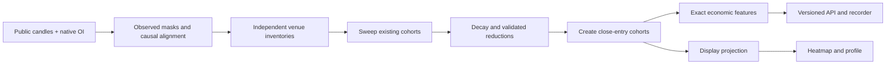

# How Open Liq works — model 2.0.0

Open Liq models **possible liquidation exposure** from public market data and explicit assumptions. It does not observe account entries, leverage, collateral, or actual pending liquidation orders. A bright band is a scenario, not a measured order-book level, a guaranteed price target, or a trading recommendation.

## The data contract

The live adapters retain native base-asset open interest from Binance and OKX, its dollar valuation, source times, observed-data masks, and the available flow prior. Every perpetual contract has both a long and a short counterparty. The model allocates an assumed vulnerable notional between sides; it does not measure the leverage of either counterparty.

New exposure is inferred from **change in native quantity**, then valued at the current bar's close. Constant contract quantity and a rising price do not create a new position. Dollar OI remains useful context, but its price-driven change is not an opening flow.

For advanced Python callers, old series that omit native OI remain a labeled `legacy_quote_delta` compatibility path. Do not use that fallback to claim native accounting. Official live/archive adapters use native quantities when available; missing native observations do not become invented quantities.

Missing, nonpositive or invalid OI breaks the flow baseline. The first valid observation after a break re-establishes the baseline; it does not create an opening cohort for the unobserved interval. An observed existing inventory can still be swept by a valid later price bar. Price bars synthesized for display cannot trigger liquidation sweeps.

Venue components retain independent baselines and cohort inventories. Aggregation sums those inventories; it does not difference a fluctuating sum of available venues. Coverage changes and exclusions are exposed as metadata. A missing venue is missing information, not evidence that its positions closed.

## Causal chronology

OKX candle, OI and taker requests use UTC-aligned periods, including explicit `12Hutc` and `1Dutc` for long bars. Candles must be confirmed and match a complete requested interval ending by the captured request cutoff. Misaligned, unfinished or missing rows remain unobserved; adjacent taker intervals are not substituted.

For each closed bar, the engine:

1. Applies the observed trade-price high/low to cohorts that already existed before that bar.
2. Applies elapsed-time decay and the documented proportional reduction when valid native OI falls.
3. Infers new exposure from the positive native OI change, valued at the close; applies the model's explicit turnover scenario where enabled.
4. Allocates that exposure across side and leverage assumptions, creating exact liquidation-price cohorts at the close.
5. Records one post-update state for economic features, heat columns and final profiles.

A wick that occurred before a close-created position cannot liquidate it. Future prices do not alter the economic inventory already computed. Sparse exact price levels drive sweeps; the display grid does not.



Rendering projects exact cohorts onto a common grid with a small mass-conserving kernel. The grid can change when the visible window changes: pixel intensities and binned shelf groupings are presentation artifacts. **Exact API features** are the appropriate research inputs when independence from rendering resolution matters.

## Liquidation price assumptions

The ordinary scenario uses isolated margin and a fixed maintenance rate of **0.5%**. The formula helpers implement venue-specific isolated calculations; account state, margin tiers, fees and collateral are not inferred from public OI.

For the zero-fee, zero-extra-margin Binance-style case:

```text
long  = entry × (1 − 1/leverage) / (1 − MMR)
short = entry × (1 + 1/leverage) / (1 + MMR)
```

At entry 100, leverage 10 and MMR 0.005, these are approximately 90.4523 and 109.4527. This is arithmetic under the stated inputs, not a claim that all accounts liquidate at those prices. OKX follows the supported helper's own venue formula.

Real venues trigger liquidation using mark price and account maintenance requirements. The current public loader path uses observed trade-price candles as a **flagged approximation** to mark-price triggers. A wick crossing is modeled depletion, not proof of an actual liquidation event.

## Three published scenarios

| Model | Leverage weights | Extra assumptions |
|---|---|---|
| 1 · Wide clusters | 5× 12%, 20× 10%, 50× 25%, 60× 53% | Neutral side allocation; no decay or volume turnover |
| 2 · Tight magnets | 20× 30%, 60× 70% | Neutral allocation; explicit volume turnover scenario; elapsed-time decay |
| 3 · Flow skew | 10× 15%, 20× 20%, 25× 20%, 50× 25%, 100× 20% | Taker share when observed; otherwise neutral allocation |

The weights are assumptions. Models 1 and 2 were originally selected by visual comparison with rendered CoinGlass charts, not estimated from account-level leverage or validated for trading returns. Model 3's taker direction is a prior about vulnerable exposure, not a measurement of opening-position direction. Account long/short ratios are not silently substituted for taker flow.

Model 2's turnover is explicitly separate from native net openings: it can create scenario exposure while net OI is flat. Its decay is normalized to elapsed time using the reference interval returned in model metadata; it no longer changes merely because the bar interval changes.

## Units, time and uncertainty

- Exposure is **estimated entry-notional USD**. It is not the current mark-to-market dollar value of all exchange positions.
- Bars are identified by open timestamps. State and feature timestamps refer to the closed bar's post-update state. Source freshness and response-generation time are different fields.
- Choose the loaded history with `range` and optionally display a shorter tail with `visible_bars`; hidden observations still seed the full inventory. An empty starting inventory means positions opened before the observation anchor are unknown. `warmup_anchor_ms` and `insufficient_history` make this limitation explicit. A longer research history is not automatically interchangeable with a short window.
- API masks and warnings distinguish observations, fills, stale sources, synthetic data and exclusions. Zero estimated exposure is not proof that a market has no positions.
- Historical archive timestamps are event times. Unless captured availability is known, they cannot prove when a value first became available to a trading system. Reconstructed as-of views are not a substitute for prospectively recorded snapshots.
- Changing model parameters is changing a strategy input. Freeze model version, parameter digest and data fingerprint in research results.

## What the tests prove

The causal regression suite checks native-unit invariance, same-bar ordering, future-prefix invariance, missing-source transitions, invalid OI recovery, exact/profile accounting and time-normalized decay. Parser tests exercise public-source fields and masks. API and research tests exercise timestamps, hashes, versioned contracts and malformed data.

These establish selected implementation properties. They do **not** establish predictive accuracy, account-level liquidation sizes, a trading edge, or numerical equivalence to CoinGlass. See [validation](VALIDATION.md) and the [release review](RELEASE_REVIEW.md) for actual evidence and remaining gates.

## Sources and scope

- [Binance open-interest statistics](https://developers.binance.com/docs/derivatives/usds-margined-futures/market-data/rest-api/Open-Interest-Statistics)
- [Binance public data archives](https://data.binance.vision/)
- [OKX API documentation](https://www.okx.com/docs-v5/en/)

The project is independent of CoinGlass and does not scrape its heatmap or redistribute its data. User-supplied reference comparisons measure agreement under an explicit alignment contract; the reference is not ground truth.
